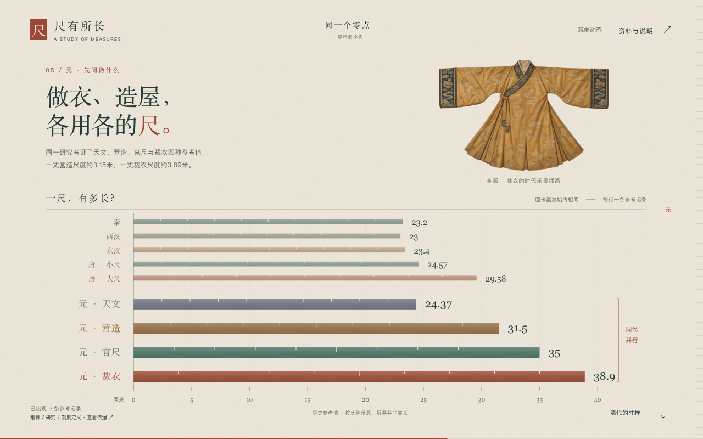

# 尺有所长 · 一部尺度小史

从寸、尺、丈的关系进入，在共同厘米尺度上逐步加入秦汉、唐、元、清与近现代的参考记录。后来的尺出现时，早期记录仍可比较；青铜量器、丝绸、袍服与建筑模型插画为时代和用途提供背景。



- [连续阅读的网页](result/index.html)
- [创作简报与提示词](prompt.md)
- [输入说明](inputs/INPUT.md)、[逐条证据](inputs/evidence.json)、[尺长与来源数据](inputs/measurements.json)
- [插画素材与生成提示词](inputs/assets/generation-prompts.json)

## 阅读与预览

开篇用一尺的拆分与十尺的接续说明单位关系，再进入同尺度历史比较。末尾可以选择两条记录，按一寸、一尺或一丈重新比较，并查看各自的来源。

在当前案例目录启动静态服务：

```bash
python3 -m http.server 8000 --bind 127.0.0.1
```

打开 <http://localhost:8000/result/>，使用桌面浏览器滚动阅读。页面的脚本、数据与插画均已随附，查看外部来源时需要联网。

## 数据与素材

资料整理于 2026-10-10，共 28 条有来源的尺度主张。正文选取 12 条记录，结尾比较提供 18 条主选记录。完整数据保留用途、地域、证据类型、研究分歧和隔离状态，不是各朝全国通行标准的连续时间序列。

来源包括中国国家博物馆藏品说明、汉尺研究、《元尺考》、地方志和近代度量衡制度条文，链接及页码随逐条证据保存。商鞅方升的尺长属于器物推算；部分记录为研究估值或转引参考值，不能把它们视为同等精度的实测。一条存在算术矛盾的三元尺记录保留在隔离组，不参与量值比较。

四张时代场景插画由 AI 生成，是叙事素材。画面中的尺长、刻度和换算由数据绘制，插画不承担文物鉴定或测量证据。

安装 `creative-data-storytelling` 后，将 `prompt.md` 与整个 `inputs/` 提供给 Agent。简报包含本例已确定的叙事路径、关键视觉关系和素材职责，用于围绕相同目标重新创作；具体构图、文字和美术由 Agent 设计。
