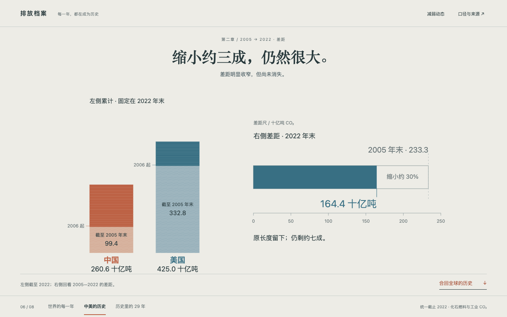

# 每一年，都在成为历史

从全球年度排放中聚焦一年，再进入中美年度与累计排放的比较，最后把局部合回全球总量，按排放时间重新切分。同一舞台串起“今年排了多少”与“历史怎样形成”两个问题。



- [完整网页](result/index.html)
- [创作简报与提示词](prompt.md)
- [输入说明](inputs/INPUT.md)、[全球年度数据](inputs/world-year.csv)、[国家年度数据](inputs/country-year.csv)
- [来源与数据版本](inputs/sources.json)、[字段定义](inputs/codebook.csv)
- [实际绘图数据](result/data.json)

## 阅读与预览

全球年度序列接到 2006 年的中美比较，年度记录再归入历史基底并累积至 2022 年。读者可先停下来查看累计结果，再用差距尺回看变化。终章回到全球累计，展示其中有多少发生在 1994—2022 年，并提供时间分界探索。

在当前案例目录启动静态服务：

```bash
python3 -m http.server 8000 --bind 127.0.0.1
```

打开 <http://localhost:8000/result/>，使用桌面浏览器滚动阅读，也可点击章节和继续按钮。网页脚本、数据与图形均在本地，无需加载图表库或外部素材；查看上游来源需要联网。

## 数据口径

输入来自 [Our World in Data CO₂ data 的固定快照](https://github.com/owid/co2-data/tree/382ee6c662b0ece26e111f263b44c029afad7787)，取得于 2026-10-13。国家表为 20 个指定国家、2000—2022 年的 460 条记录，全球表为真实 World 行、1850—2024 年的 175 条记录。本篇统一使用截至 2022 年的数据。

排放采用生产／属地口径的化石燃料与工业 CO₂，排除土地利用变化及其他温室气体。累计取上游完整历史字段，不能用国家表的 2000 年以后部分和替代；全球总量也不由 20 国子集相加得到。累计排放不是当前大气中的存量。

截至 2022 年的全球累计中，1994—2022 这 29 年约占 50.6%。结尾分界探索使用“分界前一年累计”和“2022 年累计减前段”计算，保留 1850 年以前的历史基底及来源舍入差。这个时间窗口固定截止 2022 年，不随当前日期变化。

安装 `creative-data-storytelling` 后，将 `prompt.md` 与整个 `inputs/` 提供给 Agent。简报包含本例的问题链、年度与累计的视觉承接、差距回看和时间探索，用于围绕相同目标重新创作；具体构图、文字和美术由 Agent 设计。
