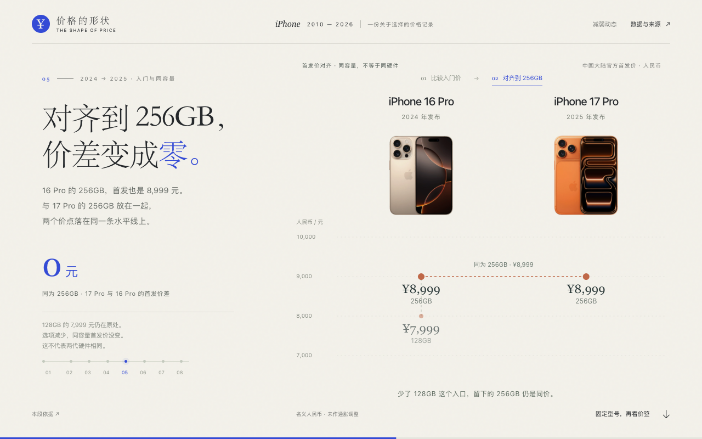

# 一部 iPhone，几种价格？

把不同机型、容量和时间的价签放进同一张价格版图。从全景定位一组手机，再连续展开局部比较，区分入门门槛、产品分层、同容量换代与同款后续调价，最后回到可探索的全景。



- [网页结果](result/index.html)
- [创作简报与提示词](prompt.md)
- [输入说明](inputs/INPUT.md)、[价格、规格与来源](inputs/data.json)
- [产品素材及出处](inputs/assets.json)

## 阅读与预览

开篇从 iPhone 4 引入。后续比较包括 iPhone 4 与 17 的起步价、2017 年的产品分层、2020 年的两组换代，以及 16 Pro 和 17 Pro 的入门价与同容量价格。局部比较共用价格尺度和对象身份，结尾可切换容量、选择机型并查看详情。

在当前案例目录启动静态服务：

```bash
python3 -m http.server 8000 --bind 127.0.0.1
```

打开 <http://localhost:8000/result/>，使用桌面浏览器滚动阅读。页面使用随附脚本、数据、产品图片和系统字体，查看外部来源时需要联网。

## 数据与素材

数据截至 2026-10-12，覆盖 51 款已开售机型的 154 个容量首发价及 8 项后续调价，并保留 122 项资料来源。这是中国大陆官方含税、无合约的名义人民币标价快照，不是运行时的实时售价、优惠成交价或通胀调整后的购买负担。年份按产品代际排列，中国大陆开售日期另行记录。

最低容量改变会影响入门价格；同容量比较仍包含屏幕、相机和芯片等硬件变化。规格、零售价、公司成本与行业存储行情分别作为证据，数据不足以把售价变化分摊为各部件的成本贡献。

产品图片来自 Apple 官方资料，完整出处与使用条件见 `assets.json`。图片用于识别机型，不按机身实长或价格缩放；部分图片含同一手机的正反两面。图片及商标的权利属于相应权利人，不包含在仓库的代码许可中。

安装 `creative-data-storytelling` 后，将 `prompt.md` 与整个 `inputs/` 提供给 Agent。简报包含本例已确定的比较顺序、全景与局部的接续、素材职责及收尾探索，用于围绕相同目标重新创作；具体构图、文字和美术由 Agent 设计。
