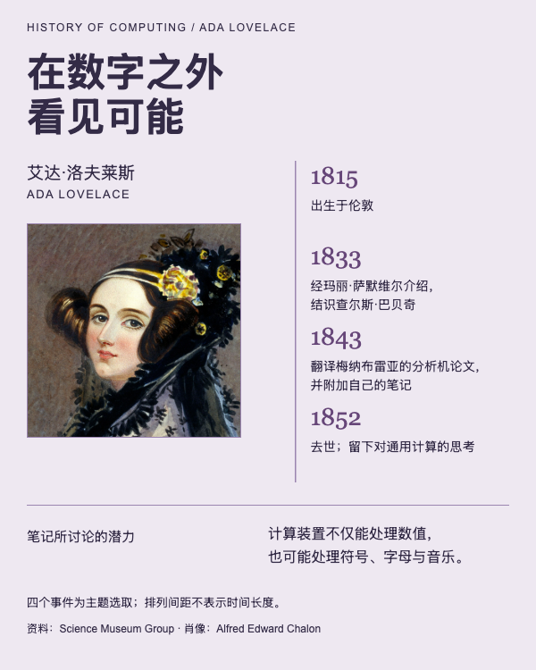

# Ada Lovelace：分析机笔记与关键事件

人物主导的事件编排、必要文字可编辑、无完整图表的HTML交付。



## 任务与输入

完整任务见[prompt.md](prompt.md)。输入包括[facts.json](inputs/facts.json)、[人物素材](inputs/portrait.jpg)与[数据及素材来源](inputs/sources.json)。真实人物事实为经来源核对后整理的任务输入，不是官方JSON导出。

选取1815年出生、1833年结识巴贝奇、1843年翻译论文并附笔记、1852年去世四个事件。1843年的论文原作者是梅纳布雷亚；不声称她制造了完整分析机，也不采用“全球第一”等绝对断言。事件间距为编辑排版，不代表经过时间。

## 结果与打开方式

[可编辑HTML](result/index.html)。只交付HTML；下方preview.png为网页展示截图，result中没有正式PNG交付。

从当前案例目录启动静态服务：

```bash
python3 -m http.server 8000 --directory result
```

浏览器打开`http://localhost:8000/`，查看固定1200px宽的编辑画布，可用浏览器缩放阅读。页面没有统计图，不加载VChart。页面使用本地图片和系统字体，无在线数据接口；已在Mac Chromium查看，字体回退可能影响其他环境的字形与换行。

## 复用与编辑

安装person-poster后，将`prompt.md`及当前`inputs/`交给支持文件、命令和浏览器的Agent；此目录无需依赖仓库中的其他案例。

已有结果的文本与数值绑定见`result/display-map.json`，数据为`result/data.json`，构建来源为`result/evidence/input-facts.json`；图表配置在实际存在的`result/charts/`。修改数据时同步来源与事实记录，不能只改生成的脚本或PNG。

将`POSTER_SKILL_DIR`设为实际安装的person-poster目录，准备Python3.10+、Pillow、Playwright及Chromium后，从本案例目录运行：

```bash
python3 "$POSTER_SKILL_DIR/scripts/poster_workflow.py" preflight --bundle result
python3 "$POSTER_SKILL_DIR/scripts/poster_workflow.py" data --bundle result
python3 "$POSTER_SKILL_DIR/scripts/poster_workflow.py" build --bundle result
python3 "$POSTER_SKILL_DIR/scripts/poster_workflow.py" review --bundle result
```

实际核对来源、600px阅读图、图表与素材，将新的真实结论写入`acceptance.json`后，执行finish；无需export。公开源稿不携带本机环境、日志与成功回执，验收状态需要在使用环境重新取得。`inputs/`用于复现原任务，编辑结果时以包内来源为准。

## 来源与使用范围

[Science Museum Group人物资料](https://collection.sciencemuseumgroup.org.uk/people/cp38764/ada-lovelace)及[1843年藏品目录](https://collection.sciencemuseumgroup.org.uk/objects/co8652385/book-sketch-of-the-analytical-engine-invented-by-charles-babbage-esq)。事实经中文整理；博物馆目录字段CC0、描述内容CC BY4.0。肖像为Alfred Edward Chalon作品的忠实复制，采用[Commons原始JPEG](https://commons.wikimedia.org/wiki/File:Ada_Lovelace_Chalon_portrait.jpg)，Public Domain / PD-Art / PDM1.0。
