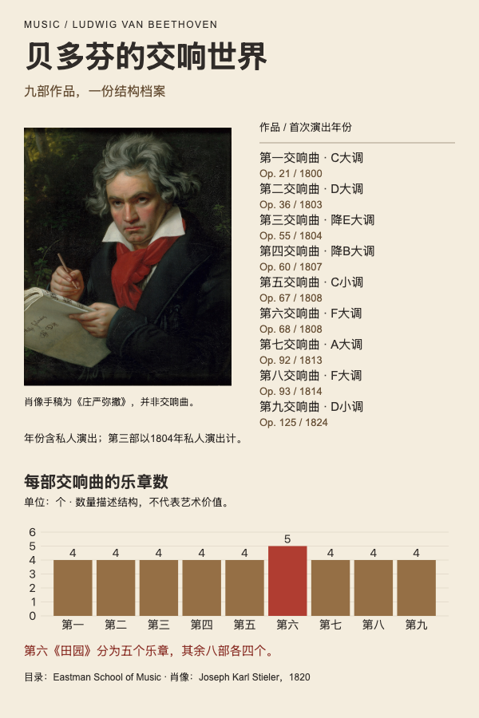

# 贝多芬：交响曲作品编年

音乐作品目录、首次演出编年、乐章数量比较。



## 任务与输入

完整任务见[prompt.md](prompt.md)。输入包括[facts.json](inputs/facts.json)、[人物素材](inputs/portrait.jpg)与[数据及素材来源](inputs/sources.json)。真实人物事实为经来源核对后整理的任务输入，不是官方JSON导出。

九部交响曲全部列出。年份采用首次演出，包含私人演出；第三交响曲标1804年私人演出，而非1805年公开首演。乐章数按目录独立条目计数，第六部五个，其余各四个；不比较艺术价值，也不使用录音时长。

## 结果与打开方式

[可编辑HTML](result/index.html)与[高清PNG](result/preview.png)（2400 × 3600像素，2x导出）。

从当前案例目录启动静态服务：

```bash
python3 -m http.server 8000 --directory result
```

浏览器打开`http://localhost:8000/`，查看固定1200px宽的编辑画布，可用浏览器缩放阅读。图表使用随结果提供的VChart2.1.7本地副本，MIT许可文件位于[result/assets/VCHART-LICENSE](result/assets/VCHART-LICENSE)。页面使用本地图片和系统字体，无在线数据接口；已在Mac Chromium查看，字体回退可能影响其他环境的字形与换行。

## 复用与编辑

安装person-poster后，将`prompt.md`及当前`inputs/`交给支持文件、命令和浏览器的Agent；此目录无需依赖仓库中的其他案例。

已有结果的文本与数值绑定见`result/display-map.json`，数据为`result/data.json`，构建来源为`result/evidence/input-facts.json`；图表配置在实际存在的`result/charts/`。修改数据时同步来源与事实记录，不能只改生成的脚本或PNG。

将`POSTER_SKILL_DIR`设为实际安装的person-poster目录，准备Python3.10+、Pillow、Playwright及Chromium后，从本案例目录运行：

```bash
python3 "$POSTER_SKILL_DIR/scripts/poster_workflow.py" preflight --bundle result
python3 "$POSTER_SKILL_DIR/scripts/poster_workflow.py" data --bundle result
python3 "$POSTER_SKILL_DIR/scripts/poster_workflow.py" build --bundle result
python3 "$POSTER_SKILL_DIR/scripts/poster_workflow.py" review --bundle result
```

实际核对来源、600px阅读图、图表与素材，将新的真实结论写入`acceptance.json`后，再执行export和finish，重新生成PNG。公开源稿不携带本机环境、日志与成功回执，验收状态需要在使用环境重新取得。`inputs/`用于复现原任务，编辑结果时以包内来源为准。

## 来源与使用范围

[Eastman School of Music作品目录](https://www.esm.rochester.edu/beethoven/symphony-no-1/)，九条作品页逐项链接见sources.json。肖像为Joseph Karl Stieler1820年作品的忠实复制，采用[Commons文件页](https://commons.wikimedia.org/wiki/File:Joseph_Karl_Stieler%27s_Beethoven_mit_dem_Manuskript_der_Missa_solemnis.jpg)公开的1920px JPEG，Public Domain / PD-Art / PDM1.0。画中手稿是《庄严弥撒》，并非交响曲。
