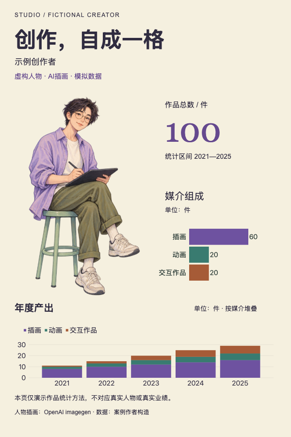

# 虚构创作者：作品与媒介

AI人物插画、年度堆叠图与媒介组成图、明确模拟数据声明。



## 任务与输入

完整任务见[prompt.md](prompt.md)。输入包括[synthetic-data.json](inputs/synthetic-data.json)、[人物素材](inputs/portrait.png)与[数据及素材来源](inputs/sources.json)。人物插画与数据均用于演示，不能作为真实人物资料。

人物为虚构成年人，数据为15条合成记录。2021—2025年度合计为11、15、20、25、29件；插画、动画、交互作品合计为60、20、20件，总计100件。所有合计由输入记录复算，不代表真实作品或业绩。

## 结果与打开方式

[可编辑HTML](result/index.html)与[高清PNG](result/preview.png)（2400 × 3600像素，2x导出）。

从当前案例目录启动静态服务：

```bash
python3 -m http.server 8000 --directory result
```

浏览器打开`http://localhost:8000/`，查看固定1200px宽的编辑画布，可用浏览器缩放阅读。图表使用随结果提供的VChart2.1.7本地副本，MIT许可文件位于[result/assets/VCHART-LICENSE](result/assets/VCHART-LICENSE)。页面使用本地图片和系统字体，无在线数据接口；已在Mac Chromium查看，字体回退可能影响其他环境的字形与换行。

## 复用与编辑

安装person-poster后，将`prompt.md`及当前`inputs/`交给支持文件、命令和浏览器的Agent；此目录无需依赖仓库中的其他案例。

已有结果的文本与数值绑定见`result/display-map.json`，数据为`result/data.json`，构建来源为`result/evidence/input-facts.json`；图表配置在实际存在的`result/charts/`。修改数据时同步来源与事实记录，不能只改生成的脚本或PNG。虚构案例还须从records重新计算annual、media和total。

将`POSTER_SKILL_DIR`设为实际安装的person-poster目录，准备Python3.10+、Pillow、Playwright及Chromium后，从本案例目录运行：

```bash
python3 "$POSTER_SKILL_DIR/scripts/poster_workflow.py" preflight --bundle result
python3 "$POSTER_SKILL_DIR/scripts/poster_workflow.py" data --bundle result
python3 "$POSTER_SKILL_DIR/scripts/poster_workflow.py" build --bundle result
python3 "$POSTER_SKILL_DIR/scripts/poster_workflow.py" review --bundle result
```

实际核对来源、600px阅读图、图表与素材，将新的真实结论写入`acceptance.json`后，再执行export和finish，重新生成PNG。公开源稿不携带本机环境、日志与成功回执，验收状态需要在使用环境重新取得。`inputs/`用于复现原任务，编辑结果时以包内来源为准。

## 来源与使用范围

人物素材实际通过OpenAI内置imagegen生成，未输入真人照片，图内明确标注AI插画；原始提示词见[portrait-prompt.txt](inputs/portrait-prompt.txt)。使用依据见[OpenAI输出条款](https://openai.com/policies/row-terms-of-use/)及sources.json；生成结果不保证唯一或排他权利。
