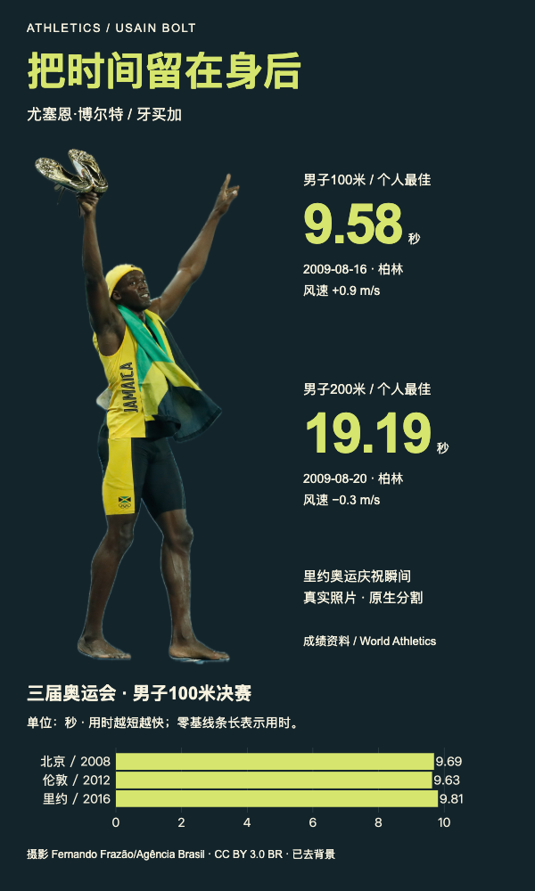

# 博尔特：短跑成绩档案

真实照片剪影、举臂动作避让、不同短跑项目与同项目决赛数据的分别表达。



## 任务与输入

完整任务见[prompt.md](prompt.md)。输入包括[已整理事实](inputs/facts.json)、[原始照片](inputs/portrait.jpg)和[数据及素材出处](inputs/sources.json)。事实由公开资料核对后整理，不是官方JSON导出。

男子100米个人最佳9.58秒，200米19.19秒，分别注明2009年柏林比赛日期和风速。两种距离分别呈现，不作直接成绩排名。图表只选取2008、2012、2016年奥运男子100米决赛，分别9.69、9.63、9.81秒；条形从零起，用时越短越快。这些记录不是完整生涯趋势。

照片拍于2016年里约庆祝时刻，不能当作2009年柏林比赛照片。

## 结果与打开方式

[可编辑HTML](result/index.html)与[高清PNG](result/preview.png)（2400 × 4000像素，2x导出）。

从当前案例目录启动静态服务：

```bash
python3 -m http.server 8000 --directory result
```

浏览器打开`http://localhost:8000/`。固定1200px宽编辑画布，可用浏览器缩放阅读。页面使用本地素材及VChart2.1.7副本，不读取在线接口；[运行时MIT许可](result/assets/VCHART-LICENSE)随包保留。字体使用Arial、PingFang SC等系统回退，已在Mac Chromium查看。

## 素材与使用范围

摄影：**Fernando Frazão/Agência Brasil**，2016-08-14。原图来自[Wikimedia Commons文件页](https://commons.wikimedia.org/wiki/File:Usain_Bolt_Rio_100m_final_2016g-cr.jpg)，许可为[CC BY3.0BR](https://creativecommons.org/licenses/by/3.0/br/)。使用时保留作者、机构、许可链接及改动说明，不表示摄影者、机构或人物背书。

改动：Apple Vision原生前景分割产生灰度蒙版，通过person-poster的prepare_subject.py添加alpha，保留1024×2160原画幅，所有2,211,840个像素的原始解码RGB不变。包内保留[原始JPEG](result/assets/original.jpg)、[灰度蒙版](result/assets/mask.png)、[透明PNG](result/assets/subject.png)与[RGB核对信息](result/assets/rgb-preservation.json)。自动蒙版的软边及极细鞋带可能不及手工精修；没有重绘五官、身体或衣服。

数据来源：[World Athletics个人档案](https://worldathletics.org/athletes/_/14201847)、[2009年100米榜](https://worldathletics.org/records/toplists/sprints/100-metres/all/men/senior/2009)、[200米榜](https://worldathletics.org/records/toplists/sprints/200-metres/all/men/senior/2009)，奥运历史用时出处见[sources.json](inputs/sources.json)。

## 复用与编辑

安装person-poster后，将本例prompt和inputs交给支持文件、命令和浏览器的Agent。复做本例原生分割需要macOS14+及Swift；现有结果已包含透明素材，打开页面无需再次分割。

文字和数值对应关系见`result/display-map.json`，数据见`result/data.json`，构建来源为`result/evidence/input-facts.json`，原生图表配置为`result/charts/olympic-finals.spec.json`。编辑时同步来源与事实记录，不能只改生成脚本或PNG。

将`POSTER_SKILL_DIR`设为实际安装目录，准备Python3.10+、Pillow、Playwright和Chromium后，从当前案例目录运行：

```bash
python3 "$POSTER_SKILL_DIR/scripts/poster_workflow.py" preflight --bundle result
python3 "$POSTER_SKILL_DIR/scripts/poster_workflow.py" data --bundle result
python3 "$POSTER_SKILL_DIR/scripts/poster_workflow.py" build --bundle result
python3 "$POSTER_SKILL_DIR/scripts/poster_workflow.py" review --bundle result
```

实际核对来源、600px阅读图、人物与图表，将新的真实结论写入acceptance.json，再运行export和finish。公开源稿不携带本机环境、日志或成功回执，验收需在使用环境重新取得。inputs保留原任务输入，编辑结果以包内来源为准。
