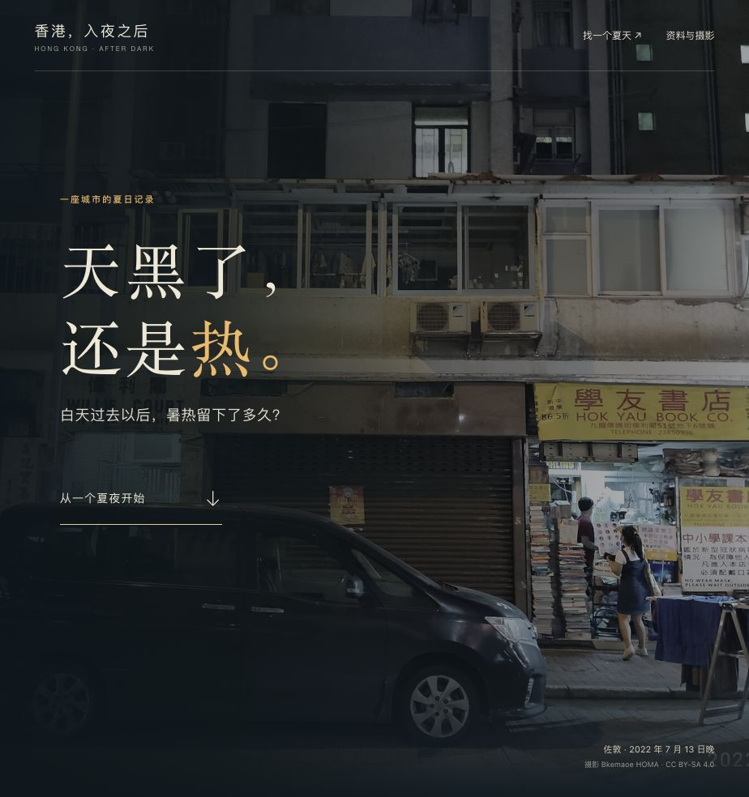

# 天黑了，还是热。

一篇关于香港夏夜的完整中文数据故事。从街景与一个夏夜进入，沿日期、夏季和长期记录展开，比较热夜的频数、连续性及气温分布，最后可选择年份查看日历。



- [查看作品](result/index.html)
- [同主题复作任务](prompt.md) · [研究输入](inputs/INPUT.md)
- [统计结果](result/data/summary.json) · [数据构建脚本](scripts/build-data.mjs)

## 查看与复作

在本案例目录启动静态服务：

```bash
python3 -m http.server 8000 --bind 127.0.0.1 --directory result
```

打开 <http://127.0.0.1:8000/>，向下滚动阅读。页面资源和数据均在本地，无运行时 CDN 依赖。面向桌面浏览器；无需构建。

给安装了 `unit-data-storytelling` 的 Agent 提供 `prompt.md` 和 `inputs/`，可重新创作同主题作品。提示词不保证逐像素重现本例。更新已提供的气温输入后，可运行 `node scripts/build-data.mjs` 重建统计数据（Node.js 20+）；图片独立保存，不由脚本重新下载。

## 数据与素材

香港天文台测站 1961–2025 年逐日观测；正文只取每年 6–8 月，共 5,980 天。热夜为日最低温至少 28°C，酷热日为日最高温至少 33°C。比较窗口为 1961–1990 与 1996–2025，各 30 年；中间年份仍在全历史画面中。单站数据不代表全市平均、体感温度或夜间平均温度，也不足以独立归因某次高温。

来源见 [sources.json](inputs/sources.json)，使用数据时保留香港天文台／香港特别行政区政府及 DATA.GOV.HK 署名，参阅[开放数据条款](https://data.gov.hk/en/terms-and-conditions)。

两幅街景由 **Bkemaoe HOMA** 拍摄于 2022 年 7 月 13 日，来自 Wikimedia Commons，采用 [CC BY-SA 4.0](https://creativecommons.org/licenses/by-sa/4.0/)。原图未改，页面使用 CSS 裁切和遮罩。原文件链接及作者、许可元数据保存在[图片来源](result/assets/image-provenance.json)及页面底部。照片用于呈现地点与日期，不是街角温度或人物感受的证据；素材许可独立于仓库代码许可。
