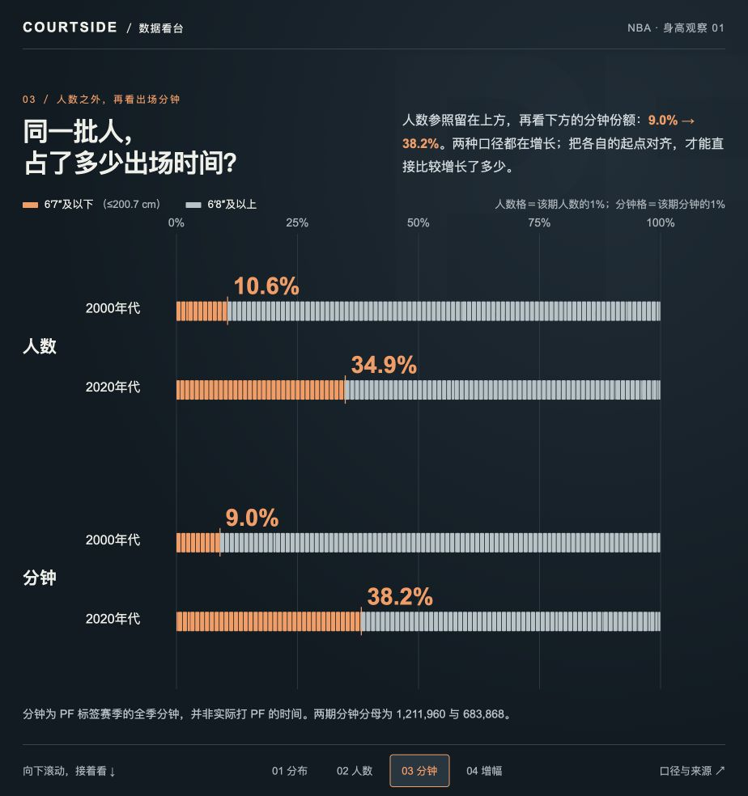

# 大前锋：人数变化与分钟变化

**局部比较示例。** 使用同一批球员记录，先比较身高分布，再将人数占比与分钟占比对齐。重点是构图与标注如何共同解释变化，展示的是一段有边界的比较，而非完整 NBA 专题。



- [查看试作](result/index.html)
- [复作任务](prompt.md) · [研究输入](inputs/INPUT.md)
- [统计结果](result/data/analysis.json) · [计算脚本](scripts/analyze.py)

## 查看

在本案例目录执行：

```bash
python3 -m http.server 8000 --bind 127.0.0.1 --directory result
```

打开 <http://127.0.0.1:8000/>，按页面引导滚动。桌面浏览器可直接加载本地资源，无需构建。用 `uv run --no-project python scripts/analyze.py` 可从 `result/data/` 中保存的原始表重建该段统计；不需额外 Python 包。

`prompt.md` 用于同题复作，不限定图形和动画路径。独立创作时只提供 Skill、任务及输入。

## 数据说明

按赛季起始年比较 2000–2009 与 2020–2025。年代内每位曾登记为 PF 的球员计一次，分别为 322 人和 261 人。后者是尚未完整的年代，比较比例而非把两期人数或总分钟直接当作相同观察量。

身高来自统一球员资料。分钟为入选 PF 赛季中的球员总分钟，不能解释成球员只在 PF 位置打的分钟。画面区分人数占比和分钟占比，不据此单独推断战术因果。原始数据为 [NBA Stats](https://www.kaggle.com/datasets/sumitrodatta/nba-aba-baa-stats) 固定快照，来源、版本和处理说明保存在输入中。
